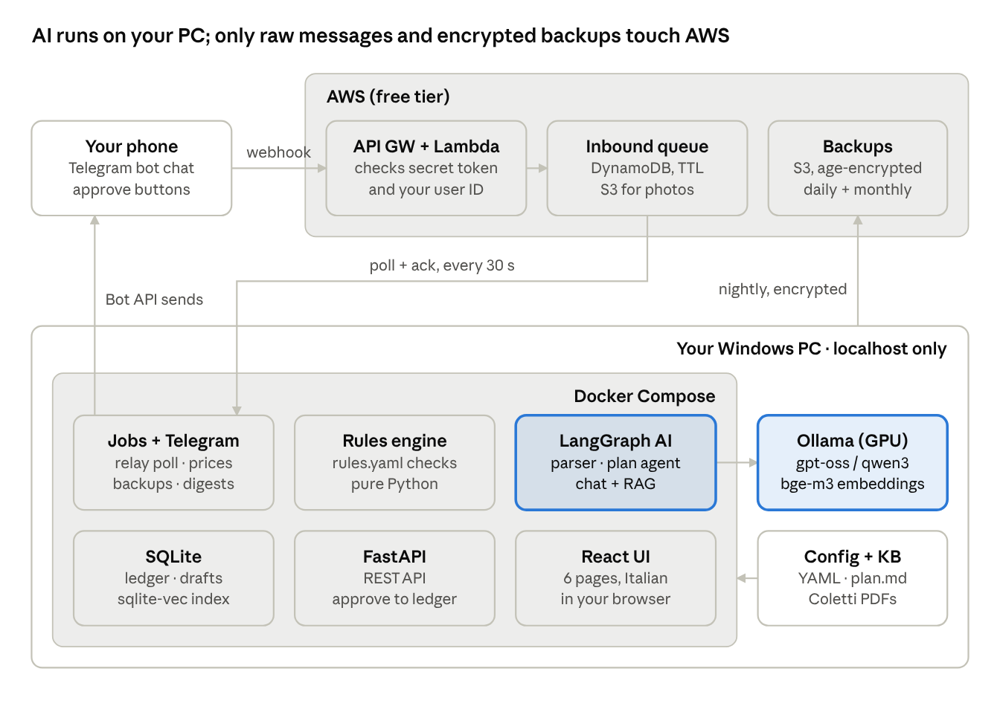
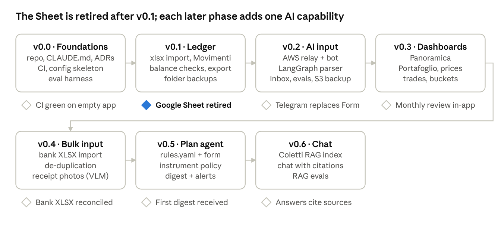

# Lodestar — Project Design

2026-10-13 · Luca Bianchi

## 0. Origin and context

**Lodestar started from Luca's brainstorm on 12 October 2026: an expense tracker that is his own rather than generic, built to keep a 25-year-old on his plan to buy a house in 2032.** The design was settled in a question-by-question review on 12–13 October 2026; every decision is recorded in this document and listed in §13.

**The owner.** Luca, 25, Data Engineer in Italy. Net salary about €1,813/month, savings rate about 46%. Passive long-term investor following Prof. Paolo Coletti's four-pillar method (course notes “Educati e Finanziati”); never trades on market moves. Wants to learn AI engineering by building, some AWS, and how to develop with a coding agent, at near-zero cost. Hardware: a Windows PC with a 16 GB GPU running Ollama (gpt-oss, qwen3:8b and similar).

**The original idea, as proposed, and where each point landed**

| Original request                                                                                                               | Where it lives                                           |
|--------------------------------------------------------------------------------------------------------------------------------|----------------------------------------------------------|
| Runs fully locally, LLMs included (Ollama)                                                                                     | §1, §4, §6                                               |
| Input from the phone via Telegram; the PC downloads new messages when it starts                                                | §7 (AWS relay, because Telegram keeps updates only 24 h) |
| Replace the Google Sheet, including the investments and portfolio sheets                                                       | §5, F3, F11                                              |
| Italian preferred, English acceptable where models work better; euros                                                          | §9, ADR 0012                                             |
| Free text becomes correctly formatted lines (€50 restaurant, friend returns €25 → two lines)                                   | §6.1                                                     |
| An agent that reasons on the plan: €700/month rule, when to buy a bond, suggestions within usual preferences; no market timing | §6.2, §6.3                                               |
| Several accounts reflected in the data model and UI                                                                            | §5                                                       |
| Coletti material used as knowledge; a chat window over plan, ledger and material                                               | §6.4                                                     |
| Receipts from photos; bank statements to add missing lines                                                                     | F12, F13 (XLSX instead of PDF, by decision)              |
| AI output saved only after a ✅/❌ confirmation                                                                                | F8, ADR 0007                                             |
| Useful dashboards, but simple and usable                                                                                       | §8                                                       |
| Open source and configurable for others                                                                                        | §9                                                       |
| Built mostly by Claude Code, with all the files an AI-driven project needs                                                     | §12, §15                                                 |

**Source material**

- **Financial plan:** `Piano_Finanziario_Luca.md` v3.1 (7 September 2026). Becomes `config/plan.md`; the rules in §6.2 cite its sections.

- **Data:** `SituazionePatrimoniale.xlsx`, 7 sheets, 282 ledger rows (29/11/2025 – 31/08/2026). Imported in v0.1; kept in `data/`, never committed.

- **Course notes:** Coletti, “Educati e Finanziati”, about 114 pages. Go in `knowledge/`, never committed.

**Luca's buckets (from plan §4.2)**

| Bucket             | Purpose                                        | Where                                         | Capital | Monthly | Risk  |
|--------------------|------------------------------------------------|-----------------------------------------------|---------|---------|-------|
| P1 Liquidità       | Current spending + buffer                      | Intesa Sanpaolo                               | €3,000  | —       | 0/10  |
| P2 Fondo emergenza | ~7 months of spending                          | XEON on Fineco                                | €7,951  | —       | 0/10  |
| P3 Casa            | Down payment + costs, Dec 2032, target €62,000 | Bonds on Fineco (instrument open)             | €16,000 | €500    | 2/10  |
| P4 Lungo termine   | 25+ years                                      | Global equity ETF on Fineco (instrument open) | €4,328  | €400    | 10/10 |

## 1. Vision and principles

**Lodestar is a local-first, AI-assisted personal finance tracker that keeps you on your own plan.** You log expenses in plain Italian from Telegram, approve AI-made drafts with one tap, and an agent checks every day's numbers against your written financial plan. Models run on your own GPU through Ollama. The code is open source (AGPL-3.0) and everything personal lives in config.

The name: a lodestar is the star you navigate by. Here the star is the plan (four pillars, house in 2032), and the app's job is to tell you whether you are still on course. It is not there to chase the market.

**The problem it solves.** Today the data lives in a Google Sheet fed by a Google Form, logged on average 6 days late (max 69). The plan lives in a separate markdown file nobody checks against the numbers. Prices come from GOOGLEFINANCE. Nothing tells you when a rule is broken or a bond purchase is due.

**Principles**

1.  **Local first.** Data, LLMs and embeddings run on your PC. The cloud (AWS) only relays raw messages and stores encrypted backups.

2.  **Human approves, AI drafts.** No AI output is written to the ledger without a click on ✅.

3.  **Code computes, LLM explains.** Every number the agent quotes comes from deterministic code (SQL, the rules engine). The LLM picks categories, extracts fields and writes explanations.

4.  **Simple beats complete.** Six pages, no more. A new feature must fit into one of them or wait.

5.  **Passive investor by design.** The agent never suggests buying or selling because the market moved. It only acts on the plan's calendar, thresholds and your written instrument policy.

6.  **One source of truth.** After the import, the app is the only ledger. No parallel sheets, no `_v2` files.

7.  **Personal, but generic.** Your pillars, accounts, categories and rules are config. Another user swaps the config and gets their own Lodestar.

8.  **Measured AI.** Every prompt or model change runs against an eval set built from real data. Models are chosen by score, not by feel.

## 2. Feature scope

**Every capability requested in the brainstorm is covered, plus three that the review surfaced** (repo setup, planned expenses, proactive notifications).

| \#  | Feature                      | What it does                                                                                                          | Phase                     |
|-----|------------------------------|-----------------------------------------------------------------------------------------------------------------------|---------------------------|
| F1  | Repo and agent setup         | `CLAUDE.md`, `CONTEXT.md`, ADRs, CI, eval harness, config skeleton                                                    | v0.0                      |
| F2  | Multi-account ledger         | One flat transactions table; Intesa, Fineco, Contanti, Revolut, Poste, etc. as configured accounts                    | v0.1                      |
| F3  | Spreadsheet import           | One-time import of all 7 sheets (282 rows, trades, watchlist, planned expenses) + the 01/03/2026 adjustment           | v0.1                      |
| F4  | Manual entry and editing     | Add, edit, delete lines in the web app                                                                                | v0.1                      |
| F5  | Balance check                | Enter a real account balance, see the gap, confirm an adjustment line                                                 | v0.1                      |
| F6  | Telegram input via AWS relay | Text, photos, files sent to the bot are queued in AWS until the PC pulls them                                         | v0.2                      |
| F7  | Natural-language parsing     | “Ristorante X 50€, l’amico me ne ha ridati 25” → two draft lines in the ledger format                                 | v0.2                      |
| F8  | Draft approval               | Drafts in the web Inbox (required) and as Telegram ✅/❌ messages, corrected by replying (optional); editable in both | v0.2                      |
| F9  | Trip mode                    | `/viaggio Zante` tags new lines until `/fine` or auto-expiry; tag removable per draft                                 | v0.2                      |
| F10 | Dashboards                   | Monthly spend, savings rate, net worth over time, by category, account and tag                                        | v0.3                      |
| F11 | Portfolio                    | Trades, positions, prices (yfinance + MOT scraper + manual), buckets vs target                                        | v0.3                      |
| F12 | Bank XLSX import             | Import Intesa/Fineco XLSX exports; de-duplicate against the ledger; unsure matches become drafts                      | v0.4                      |
| F13 | Receipt photos               | A small VLM reads a receipt and makes a draft (model chosen later)                                                    | v0.4                      |
| F14 | Rules engine                 | `rules.yaml` checked by code: €700 discretionary cap, valve, P1 range, contributions, P3 trajectory                   | v0.5                      |
| F15 | Rules form                   | “Regole” form on the Piano page writes `rules.yaml`                                                                   | v0.5                      |
| F16 | Planned expenses             | Car €10,000, phone €300 and future ones, with expected date and status                                                | v0.5                      |
| F17 | Plan agent                   | Explains rule status, says when a bond purchase is due, ranks candidates within your instrument policy                | v0.5                      |
| F18 | Notifications                | Monthly digest (required) + event alerts (optional) on Telegram                                                       | v0.5                      |
| F19 | Knowledge base (RAG)         | Coletti material (~114 pages) indexed locally, cited in answers                                                       | v0.6                      |
| F20 | Chat                         | One chat over ledger, portfolio, rules, plan and knowledge base                                                       | v0.6                      |
| F21 | Backups                      | Nightly encrypted backup to S3 and/or a synced folder                                                                 | v0.1 (folder) · v0.2 (S3) |
| F22 | Export                       | Ledger to XLSX/CSV at any time                                                                                        | v0.1                      |

## 3. Non-goals

**What Lodestar will deliberately not do, so scope stays honest.**

- **No trading signals.** No buy/sell suggestions based on price moves, momentum or news.

- **No bank connections** (PSD2/open banking). Data enters via Telegram, the web app and XLSX exports only.

- **No PDF bank statements** for now. XLSX only.

- **No multi-user, no login.** One person per install, localhost only.

- **No public web exposure.** The phone talks to Telegram, never to the PC.

- **No multi-currency.** EUR everywhere.

- **No per-category budgets** beyond the rules in `rules.yaml`.

- **No automatic writes.** Nothing the AI produces reaches the ledger without approval.

- **No redistribution of course material.** The Coletti documents stay on each user's disk.

## 4. Architecture

**Three places, one direction of trust: the phone sends, AWS only queues and stores ciphertext, and everything that reads or reasons about your money runs on your PC.**

The PC pulls from the relay; nothing on the internet can reach the PC. Price providers (yfinance, Borsa Italiana/MOT) are called by the jobs service and are the only other outbound traffic.

**Main flows**

1.  **Log an expense:** phone → relay queue → poller → LangGraph parser (Ollama) → draft in SQLite → Inbox + Telegram message → you approve → ledger line.

2.  **Monthly check:** scheduler → rules engine computes status → plan agent writes the digest → Telegram.

3.  **Ask a question:** React chat → FastAPI → LangGraph agent with tools (ledger queries, rules, portfolio, knowledge search) → cited answer.

4.  **Bank reconciliation:** upload XLSX in the Inbox → deterministic parse → de-duplication against the ledger → drafts for new or uncertain lines.

5.  **Backup:** nightly SQLite snapshot → `age` encryption → S3 and/or synced folder.

## 5. Data model

**The ledger keeps the sheet's simplicity: one flat line per money movement, and the direction comes from the accounts.** Only `from_account` set = expense; only `to_account` set = income or refund; both set = transfer. A refund is just an income line in the same category, as today.

Field usage measured on the current sheet (282 rows, 29/11/2025 – 31/08/2026) decided what stays:

| Sheet column                        | Filled | Lodestar field                             |
|-------------------------------------|--------|--------------------------------------------|
| Data, Categoria, Importo            | 100%   | `date`, `category`, `amount` (always \> 0) |
| Sottocategoria (21 columns)         | 85%    | `subcategory` (one column)                 |
| Da                                  | 85%    | `from_account`                             |
| Note                                | 67%    | `note`                                     |
| A                                   | 17%    | `to_account`                               |
| Tag                                 | 15%    | `tag`                                      |
| Tracciamento in Entrate/Uscite = No | 3 rows | `exclude_from_stats`                       |
| Informazioni cronologiche           | 100%   | `created_at`                               |
| Importo per pivot E/U               | 96%    | dropped: derived from accounts             |

**Tables**

| Table              | Key fields                                                                                                           | Notes                                                                             |
|--------------------|----------------------------------------------------------------------------------------------------------------------|-----------------------------------------------------------------------------------|
| `transactions`     | id, date, amount, from_account, to_account, category, subcategory, note, tag, exclude_from_stats, source, created_at | `source` = manual · telegram · receipt · bank_xlsx · import · adjustment          |
| `drafts`           | id, status, payload (proposed lines as JSON), origin message, confidence, dedupe_hint, created_at                    | status = pending · approved · rejected; approval copies lines into `transactions` |
| `inbound_messages` | id, telegram_update_id, kind (text/photo/document/callback), body or S3 key, received_at, processed_at               | Raw queue drained from the AWS relay; idempotent on `telegram_update_id`          |
| `trades`           | id, date, instrument_id, side, quantity, price, fees, account, transaction_id                                        | Each trade creates its linked cash line (excluded from stats)                     |
| `instruments`      | id, ticker, isin, name, asset_class, tax_rate, price_provider, bucket                                                | Asset class: equity ETF, money-market ETF, govt bond, etc.; tax 12.5% or 26%      |
| `prices`           | instrument_id, date, price, source                                                                                   | Daily refresh at startup                                                          |
| `buckets`          | defined in config                                                                                                    | Your 4 pillars: name, purpose, risk, target, monthly contribution, horizon        |
| `planned_expenses` | id, name, amount, expected_date (nullable), status, note                                                             | From the “Spese di Emergenza” sheet                                               |
| `balance_checks`   | id, account, date, real_balance, computed_balance, adjustment_transaction_id                                         | Reconciliation history                                                            |
| `kb_chunks`        | id, document, page, text, embedding                                                                                  | RAG index (sqlite-vec)                                                            |

**Accounts and categories** are config, not tables: each account has a name, type (cash, bank, broker, postal), bucket and an `is_default` flag; categories keep the emoji names and subcategory lists from the sheet (`🍸 Cibo fuori / Bevute` → Bar, Pub, Pizzeria…).

**Starting values from the sheet.** Accounts: Intesa Sanpaolo (default), Fineco, Contanti, Poste Italiane, Revolut, Trade Republic (Unicredit appears only in the older “LOG EU” sheet). Categories: 💼 Stipendio, 🛒 Supermercato, 🍸 Cibo fuori / Bevute, 🚙 Auto, 🎾 Sport, 🏠 Casa, 🏠 Affitto, 👕 Abbigliamento, 🔁 Abbonamenti, 🎉 Divertimento, 📈 Investimenti, 🎁 Regali, ✈️ Viaggi, 💇 Cura / Benessere, 🚊 Trasporto pubblico, ⚕️ Salute, 🎭 Cultura, 💻 Tecnologia, 📦 Amazon, 📦 Altro. The importer keeps each row's original category and subcategory; rows with both accounts set are transfers and drop out of income/expense stats automatically.

**Import mapping (one-time).**

- “Log EntrateUscite” → `transactions` (the older “LOG EU” and “DA COPIARE” are checked for rows not already present).

- “Log Transazioni” → `trades` + `instruments` (XEON 53 @ 149.7419 on 29/07/2026; the other tickers become watchlist instruments with no position).

- “Patrimonio”, “EU”, “Dati e Calcoli” → not imported: they are computed views that Lodestar recomputes. Tag list and asset-class list seed the config.

- “Spese di Emergenza” → `planned_expenses`.

- Adds the 01/03/2026 “Riallineamento saldi” adjustment the plan requires (€7,747.57), then a balance check per account against 31/08/2026.

## 6. AI design

**All AI runs locally through Ollama's OpenAI-compatible API and is orchestrated with LangGraph.** Each task has its own model in config, so it can be swapped without code changes and compared on the eval set.

| Task                              | Default model               | Notes                               |
|-----------------------------------|-----------------------------|-------------------------------------|
| Message parsing, plan agent, chat | `gpt-oss:20b` or `qwen3:8b` | Winner chosen by eval score in v0.2 |
| Receipt photos                    | small VLM (Ovis-class), TBD | Decided in v0.4                     |
| Embeddings                        | `bge-m3`                    | Multilingual, good on Italian       |

Only one model fits in 16 GB VRAM at a time; Ollama swaps them. Batch jobs (XLSX import, RAG indexing) run one model at a time.

### 6.1 Parsing pipeline (v0.2)

A LangGraph graph turns one inbound message into one draft:

1.  **Load context:** today's date, accounts, categories with subcategories, active trip tag, default account (Intesa Sanpaolo; Contanti when the message says “contanti” or similar).

2.  **Retrieve examples:** the 5 most similar past transactions (embedding search over notes and descriptions) as few-shot examples, so “Zi nenè” maps to Pizzeria.

3.  **Extract:** structured output into a Pydantic schema `list[ProposedLine]` (date, amount, from/to account, category, subcategory, note, tag). Category must come from the configured list.

4.  **Validate in code:** amount \> 0, known account and category, date not in the future; one retry with the validation errors fed back.

5.  **Create draft** and notify (web Inbox + Telegram).

6.  **Corrections:** a reply to the draft in Telegram (“no, era contanti”) or an edit in the web app produces a new draft version. Telegram replies go back through step 3 with the previous draft as context.

Dates: “oggi” by default; “ieri”, “sabato”, “il 3” resolved relative to the message's send time, not the time it was processed.

### 6.2 Rules engine (v0.5)

**Code computes, the LLM explains.** `rules.yaml` holds typed rules; a Python evaluator returns a status (ok · warning · breach) and the numbers behind it. Initial rules, from plan v3.1 and your own:

| Rule              | Check                                                                                | Source    |
|-------------------|--------------------------------------------------------------------------------------|-----------|
| Discretionary cap | Discretionary spending this month ≤ €700 (categories marked discretionary in config) | Your rule |
| P1 range          | Intesa between €1,500 and €3,500                                                     | Plan §15  |
| Safety valve      | Intesa \< €1,500 → next month's contributions halve (250 + 200)                      | Plan §5.3 |
| Surplus           | End of quarter, Intesa \> €3,000 → excess to P3 (until 2029) or P4                   | Plan §5.2 |
| Contributions     | €500 to P3 and €400 to P4 left Intesa this month                                     | Plan §5.1 |
| Uninvested cash   | Cash on Fineco assigned to P3/P4 not invested after N days → “bond/ETF purchase due” | Plan §1.2 |
| P3 trajectory     | P3 value vs the §7 projection for that date                                          | Plan §7   |
| Emergency fund    | P2 ≥ 7 months of average spending                                                    | Plan §4.4 |
| Never touch P2/P4 | Any outflow from P2 or P4 accounts raises a warning                                  | Plan §13  |

The Regole form on the Piano page edits these values; the YAML stays hand-editable and validated by a Pydantic schema.

### 6.3 Plan agent (v0.5)

A LangGraph agent with read-only tools: `get_rule_status`, `query_ledger` (parameterised queries, never free SQL), `get_portfolio`, `get_planned_expenses`, `read_plan_section`, `search_instruments`. It produces the monthly digest and answers “what should I do this month?”.

**Instrument policy** (`instrument_policy.yaml`, written by you): allowed asset classes per bucket, issuers, maturity window (2031–2033 for P3), preferences (low coupon, single government bonds over bond ETFs for the 12.5% tax) and the §9.4 blacklist. When a purchase is due, the agent fetches candidates allowed by the policy, ranks them by net yield to maturity in code, and explains the top few. It never cites price trends; the system prompt and a post-check both enforce this.

### 6.4 Knowledge base and chat (v0.6)

- **Indexing:** the Coletti PDFs (~114 pages) in `knowledge/` are split by section (~500 tokens, 15% overlap), embedded with `bge-m3`, stored in SQLite via `sqlite-vec`. Re-indexed when files change.

- **Chat:** a LangGraph agent with the plan-agent tools plus `search_knowledge`. Every answer cites its sources: page numbers for the course material, rule names for the plan, dates for ledger rows.

- **Guardrails:** no market-timing advice; financial answers end with the plan's disclaimer; questions outside the data and the knowledge base are answered as general knowledge, labelled as such.

### 6.5 Evals

**The eval set is the backbone of every AI change.**

- **Parsing evals:** ~150 Italian messages paired with the exact lines they must produce. Built from the 282 real rows (the LLM writes a plausible message for a row, you check it) plus hand-written tricky cases (split bills, refunds, “ieri”, cash, trips).

- **Metrics:** exact match per field, line count accuracy, category accuracy, amount accuracy.

- **RAG evals (v0.6):** ~30 questions on the course material with expected source pages; metric = retrieval hit rate and judged answer faithfulness.

- Run with `make eval`; results saved per model and prompt version; CI runs a fast subset with a mocked model.

## 7. Telegram and the AWS relay

**A tiny serverless relay stores Telegram messages until the PC is on, because Telegram keeps undelivered bot updates for 24 hours at most.** The relay never parses or reasons; it only queues raw input.

**Inbound (phone → PC)**

1.  Telegram calls the webhook: API Gateway (HTTP API) → Lambda `ingest` (Python).

2.  Lambda checks the `X-Telegram-Bot-Api-Secret-Token` header and that the sender is your Telegram user ID; anything else gets a 200 and is dropped.

3.  Text and button presses go to DynamoDB table `inbound` (key: `update_id`, TTL 30 days). Photos and documents are downloaded to an S3 bucket (`inbound/`, lifecycle 30 days) and referenced by key.

4.  Lambda replies “📥 Ricevuto, lo elaboro appena il PC è acceso”.

5.  The local app polls the relay every 30 s while running (via a signed Lambda Function URL or API Gateway route with an API key), stores rows in `inbound_messages`, then calls `ack` to delete them from DynamoDB/S3.

**Outbound (PC → phone)** goes straight from the local app to the Telegram Bot API: drafts with inline buttons, confirmations, digests and alerts. No inbound port is ever opened on the PC.

**Button presses** (✅/❌ on a draft) are Telegram `callback_query` updates; they travel through the same relay. If the PC is off, the button press waits in the queue like any message.

**Bot commands:** `/viaggio <nome>`, `/fine`, `/stato` (rule summary), `/annulla` (reject last draft), `/aiuto`.

**Infrastructure as code:** AWS SAM (or Terraform) in `infra/`; one `make deploy-relay`. Expected cost ≈ €0: API Gateway, Lambda and DynamoDB requests stay far below free-tier volumes for one person.

**Backups (F21):** nightly job copies the SQLite file with the SQLite online backup API, encrypts it client-side with `age`, and writes it to the targets enabled in config: `s3` (lifecycle: 30 daily, 12 monthly) and/or `folder` (e.g. a OneDrive or Google Drive folder). AWS only ever sees ciphertext.

## 8. UX: six pages and notifications

**The web app has exactly six pages, in Italian; any new feature must fit into one of them.**

| Page            | Purpose                           | Main elements                                                                                                                                       | Phase |
|-----------------|-----------------------------------|-----------------------------------------------------------------------------------------------------------------------------------------------------|-------|
| **Inbox**       | Review AI drafts                  | Draft cards with the original message, proposed lines (editable inline), ✅/❌, “possibile duplicato” flag, bulk approve for XLSX imports           | v0.2  |
| **Movimenti**   | The ledger                        | Filterable table (date, account, category, tag, text), inline edit, add line, export XLSX/CSV, balance check per account                            | v0.1  |
| **Panoramica**  | How this month and this year went | Spend this month vs the €700 cap, savings rate (monthly, 12-month), net worth over time, spending by category, account balances, trip totals by tag | v0.3  |
| **Portafoglio** | Where the money sits              | Buckets vs target allocation, positions with value and P/L, trades log, add trade                                                                   | v0.3  |
| **Piano**       | Am I on plan?                     | Rule status as traffic lights with the numbers behind them, planned expenses, P3 trajectory vs projection, Regole form, instrument policy view      | v0.5  |
| **Chat**        | Ask anything                      | Chat with cited sources (ledger rows, rules, plan sections, course pages)                                                                           | v0.6  |

**Design rules:** one primary action per page; numbers in Italian format (€ 1.234,56); no chart without a question it answers; the Panoramica fits on one laptop screen without scrolling.

**Notifications (Telegram)**

- **Monthly digest** (required), sent on the 1st or the first start after it: the plan's “five numbers to watch” (§15), rule status, last month's spend vs cap, anything due.

- **Event alerts** (optional, each toggleable): safety valve triggered, contributions missing by the 5th, uninvested P3/P4 cash, planned expense due within 60 days, rule breach.

- Nothing else. The plan says to look at the portfolio once a month; the app respects that.

## 9. Configuration and open-source posture

**Everything personal lives outside git; the repo ships a complete fake profile so anyone can run it in five minutes.**

    lodestar/
      config.example/          # committed: fake persona, fake plan, fake data
      config/                  # git-ignored: your real profile
        settings.yaml          # locale, currency, models per task, backup targets, notifications
        accounts.yaml          # accounts, types, default account, bucket mapping
        categories.yaml        # categories, subcategories, discretionary flag
        buckets.yaml           # your 4 pillars: purpose, risk, target, contribution, horizon
        rules.yaml             # rule thresholds (also edited via the Regole form)
        instrument_policy.yaml # allowed instruments, blacklist, maturity window, preferences
        plan.md                # the financial plan the agent reads
      knowledge/               # git-ignored: Coletti PDFs or any user material
      data/                    # git-ignored: lodestar.db, raw uploads
      .env                     # git-ignored: Telegram token, AWS profile, age public key

- **License:** AGPL-3.0. Anyone may use and modify it; a hosted version must publish its source.

- **Language:** code, comments, docs, prompts, commit messages in English. UI strings via i18n files, Italian default, English included. Your Telegram messages are in Italian.

- **Currency:** EUR only, Italian number formatting by locale.

- **Copyright:** course material is never committed; `knowledge/` holds a README explaining what to drop in.

- **Privacy:** no telemetry. The only outbound traffic: Telegram API, the AWS relay, price providers, backup targets.

- **Onboarding for others:** `cp -r config.example config`, edit YAML, `docker compose up`, open `localhost`. A setup wizard in the app is a later nice-to-have, not v1.

## 10. Tech stack

**Python for everything AI and data, React for the UI, LangGraph for orchestration.** LangGraph was chosen for job-market relevance: in an April 2026 analysis of 534 agentic-AI job ads, LangChain appeared in 34% and LangGraph in 22%, against 2.4% for PydanticAI ([source](https://agentic-engineering-jobs.com/langchain-job-market-2026)).

| Layer            | Choice                                                                                                                                                   |
|------------------|----------------------------------------------------------------------------------------------------------------------------------------------------------|
| Backend          | Python 3.12, FastAPI, Pydantic v2, SQLModel/SQLAlchemy 2, Alembic migrations, `uv` for packaging                                                         |
| Database         | SQLite (WAL mode) + `sqlite-vec` for embeddings                                                                                                          |
| AI orchestration | LangGraph + `langchain-ollama`; structured output via Pydantic schemas                                                                                   |
| Models           | Ollama (native on Windows, GPU), OpenAI-compatible endpoint configurable                                                                                 |
| Scheduler        | APScheduler inside the backend (relay polling, prices, backups, digest)                                                                                  |
| Frontend         | React + TypeScript, Vite, TanStack Query + TanStack Table, Tailwind + shadcn/ui, Recharts, i18next                                                       |
| Telegram         | `python-telegram-bot` (send only; receive via relay)                                                                                                     |
| Prices           | `yfinance` (ETFs), Borsa Italiana/MOT scraper (BTPs), manual entry                                                                                       |
| Excel            | `openpyxl` (import of the sheet and bank XLSX)                                                                                                           |
| AWS relay        | Python Lambda, API Gateway HTTP API, DynamoDB, S3; AWS SAM                                                                                               |
| Backups          | SQLite backup API + `age` encryption; S3 and/or folder targets                                                                                           |
| Quality          | pytest, Ruff, mypy (strict on `domain/`), Vitest + ESLint for the frontend, pre-commit                                                                   |
| CI               | GitHub Actions: lint, type-check, tests, fast eval subset with a mocked LLM                                                                              |
| Runtime          | Docker Desktop + WSL2 on Windows; `docker compose up`, `restart: unless-stopped`; Ollama reached at `host.docker.internal:11434`; UI on `localhost` only |

## 11. Roadmap

**Seven phases, each usable on its own; the Google Sheet is retired at the end of v0.1 and the Google Form at the end of v0.2.** No dates are fixed: it's a side project, so the gates matter, not the calendar.

Each phase becomes a GitHub milestone; each item below becomes an issue.

**v0.0 · Foundations**

- Monorepo `backend/`, `frontend/`, `infra/`, `evals/`, `docs/`; `uv` + `pnpm`; Docker Compose with Ollama on the host

- `CLAUDE.md` files, `CONTEXT.md`, ADRs 0001–0014, `.claude/commands/`

- `config.example/` with a fake persona and ~300 fake ledger rows

- CI: lint, types, tests; eval runner skeleton

**v0.1 · Ledger**

- Schema + Alembic migrations; config loaders with Pydantic validation

- Importer for the 7-sheet xlsx, with a dry-run report and the 01/03/2026 adjustment

- Movimenti page: table, filters, add/edit, export

- Balance checks per account

- Folder backup job + restore command

**v0.2 · AI input**

- AWS relay (SAM/Terraform): ingest Lambda, queue, poll/ack endpoints, S3 for files

- Poller + `inbound_messages`; Telegram sender

- LangGraph parsing graph with few-shot retrieval (bge-m3 + sqlite-vec index of past transactions) and validation retry

- Inbox page; draft edit and versions

- Telegram ✅/❌ and reply-to-correct (optional)

- Trip mode commands and auto-expiry

- Parsing eval set (~150 cases); model choice gpt-oss vs qwen3 by score

- S3 encrypted backups

**v0.3 · Dashboards and portfolio**

- Panoramica page

- Instruments, trades (with auto cash line), price providers

- Portafoglio page with buckets vs target

**v0.4 · Bulk input**

- Intesa and Fineco XLSX parsers; de-duplication; drafts for uncertain matches

- Receipt photo pipeline with a small VLM and its own eval set

**v0.5 · Plan agent**

- `rules.yaml` schema, evaluator, Regole form

- Planned expenses; Piano page

- Instrument policy + candidate ranking

- Plan agent; monthly digest; event alerts

- “No market timing” eval cases

**v0.6 · Knowledge and chat**

- PDF ingestion, chunking, `bge-m3` embeddings, `sqlite-vec`

- Chat agent with tools and citations; Chat page

- RAG eval set (~30 questions)

## 12. AI-driven development setup

**The repo is written so Claude Code can pick up any issue cold and work like a normal team member: context in files, work in issues, quality enforced by CI.**

| File / practice                           | Purpose                                                                                                                                                                    |
|-------------------------------------------|----------------------------------------------------------------------------------------------------------------------------------------------------------------------------|
| `CLAUDE.md` (root)                        | How to run, test, lint and eval; repo map; coding conventions; “never” rules (no real data in tests, no writes without drafts, no market-timing logic, no secrets in code) |
| `backend/CLAUDE.md`, `frontend/CLAUDE.md` | Layer-specific conventions, loaded when working in that folder                                                                                                             |
| `CONTEXT.md`                              | Domain glossary: transazione, conto, bucket/pilastro, bozza, regola, valvola, spesa pianificata, policy strumenti; how direction is derived from accounts                  |
| `docs/design.md`                          | This document, exported, kept in sync                                                                                                                                      |
| `docs/adr/NNNN-*.md`                      | One ADR per decision (seeds in §13); new decisions get a new ADR, never an edit                                                                                            |
| GitHub milestones + issues                | One milestone per phase; each issue = one vertical slice with acceptance criteria and test notes                                                                           |
| `.claude/commands/`                       | Repeatable prompts: `/new-issue`, `/implement-issue <n>`, `/run-evals`, `/new-adr`                                                                                         |
| `.claude/settings.json`                   | Allowed commands (`uv`, `pnpm`, `make`, `pytest`), hooks that run Ruff and tests after edits                                                                               |
| `Makefile`                                | `make dev`, `make test`, `make eval`, `make lint`, `make deploy-relay`                                                                                                     |
| `evals/`                                  | Golden datasets (fake data in git, real data git-ignored), runner, results history                                                                                         |
| Fixtures                                  | `config.example/` + a fake ledger of ~300 rows so tests never need real data                                                                                               |

**Working loop with Claude Code:** pick an issue → Claude Code plans in plan mode → implements test-first → CI green → you review the PR and merge. AI-behaviour changes must show eval results in the PR description.

**Code structure** (backend): `domain/` (pure logic: ledger, rules, buckets; no I/O), `ai/` (LangGraph graphs, prompts, schemas), `adapters/` (SQLite, Telegram, relay, prices, backups), `api/` (FastAPI routes). Dependencies point inward to `domain/`, which keeps the important logic testable without models or network.

## 13. Decision log

**Each row becomes an ADR in `docs/adr/` during v0.0.** All decided 12–13 October 2026.

| ADR  | Decision                                                                      | Rejected alternative                       | Why                                                                   |
|------|-------------------------------------------------------------------------------|--------------------------------------------|-----------------------------------------------------------------------|
| 0001 | The app is the only source of truth; the Google Sheet is retired after import | Two-way sync; AI layer on top of the Sheet | Sync is costly and fragile; the wide sheet format limits the model    |
| 0002 | Flat ledger, direction derived from from/to accounts                          | Typed double-entry with linked refunds     | Matches how the sheet already worked; simplest to reason about        |
| 0003 | Telegram via an AWS serverless relay                                          | Bot on the PC only; always-on PC           | Telegram keeps updates for 24 h max; relay costs ≈ €0 and teaches AWS |
| 0004 | Local LLMs via Ollama's OpenAI-compatible API, one model per task             | A single model; cloud LLM                  | Privacy, zero cost, swappable models                                  |
| 0005 | LangGraph for all AI orchestration from v0.2                                  | Raw calls first; PydanticAI                | Job-market relevance; you prefer to learn by doing                    |
| 0006 | Hybrid plan logic: rules in YAML checked by code, LLM explains                | LLM reasons over the markdown plan alone   | Small models are unreliable at arithmetic                             |
| 0007 | Drafts always approved by a human                                             | Auto-insert above a confidence threshold   | Financial ledger; trust matters more than speed                       |
| 0008 | Instrument policy written by the user                                         | Infer preferences from past trades         | Only 1 trade in history; preferences must be explicit                 |
| 0009 | FastAPI + SQLite backend, React frontend                                      | Streamlit/NiceGUI                          | Better CRUD and dashboards; more credible open-source project         |
| 0010 | Bank import from XLSX only                                                    | PDF parsing with an LLM                    | Deterministic and reliable; PDFs deferred                             |
| 0011 | Backups: encrypted S3 and/or synced folder, chosen in config                  | No backup; unencrypted copies              | Single file holds all history; AWS sees only ciphertext               |
| 0012 | English code and prompts, Italian UI, EUR only                                | Italian everywhere                         | Better model instruction-following; wider open-source audience        |
| 0013 | AGPL-3.0, single user per install, personal data outside git                  | MIT; multi-tenant                          | Prevents closed SaaS forks; keeps scope small                         |
| 0014 | Six pages maximum                                                             | Feature-per-page growth                    | Usability over completeness                                           |

## 14. Risks and open points

**The biggest risk is scope: seven phases is a lot for a side project, so each phase must be usable on its own.**

| Risk                              | Impact                        | Mitigation                                                                              |
|-----------------------------------|-------------------------------|-----------------------------------------------------------------------------------------|
| Scope creep stalls the project    | No working app                | Phases ship independently; v0.1 + v0.2 already replace the Sheet and Form               |
| Small models mis-parse messages   | Wrong ledger lines            | Drafts always reviewed; eval set gates prompt/model changes; few-shot from similar rows |
| Data loss (one SQLite file)       | All history lost              | Nightly encrypted backups from v0.1; restore tested in CI with a fake DB                |
| Telegram buttons add complexity   | v0.2 slips                    | Telegram approval is optional; web Inbox is the required path                           |
| MOT/Borsa Italiana scraper breaks | Stale bond prices             | Manual price entry fallback; stale-price warning after 7 days                           |
| Docker + GPU + Windows friction   | Slow setup                    | Ollama stays native; containers only reach it over HTTP                                 |
| Model swapping in 16 GB VRAM      | Slow responses                | One model per job batch; keep the parser model loaded during Inbox work                 |
| Agent drifts into market advice   | Breaks your passive principle | System prompt + output post-check + a dedicated eval case set                           |
| Plan and `rules.yaml` diverge     | Agent checks the wrong rules  | Each rule names the plan section it comes from; plan changes trigger a rules review     |

**Open points (decided later, not blocking v0.0–v0.2)**

- VLM for receipts (Ovis-class, ≤ 8B), picked in v0.4 with its own eval set.

- Parsing model: `gpt-oss:20b` vs `qwen3:8b`, picked by eval score in v0.2.

- Which categories count as “discretionary” for the €700 cap (set in `categories.yaml` before v0.5).

- Instrument policy content (you write it before v0.5; depends on the plan's open points A and B).

- AWS SAM vs Terraform for the relay (decide at the start of v0.2).

- Exact format of Intesa and Fineco XLSX exports (sample files needed in v0.4).

- Whether the 7 sheets contain rows in “LOG EU” or “DA COPIARE” missing from the main log (checked by the importer in v0.1).

## 15. Handoff to Claude Code

**Claude Code builds Lodestar as a normal project: it writes the code, Luca reviews and merges the PRs, and no teaching mode is needed.** Its job is to have all the context it needs in the repo itself.

**What goes into the repo before the first coding session**

- This document as `docs/design.md`. Markdown export drops the two diagrams, so also commit a PDF export as `docs/design.pdf`.

- `CLAUDE.md`, `CONTEXT.md` and ADRs 0001–0014, generated from this document (§12, §13).

- `config.example/` with a fake persona; Luca's real `config/plan.md` and the xlsx stay local and git-ignored.

**First session**

1.  Open the repo in Claude Code; it reads `CLAUDE.md` automatically.

2.  Ask it to read `docs/design.md`, then create the v0.0–v0.2 GitHub milestones and issues from the §11 checklists.

3.  Implement v0.0 issue by issue: plan mode first, tests first, one PR per issue.

**Rule for later changes:** when a decision changes, update this document and add a new ADR in the same PR, so the design and the code never diverge.
